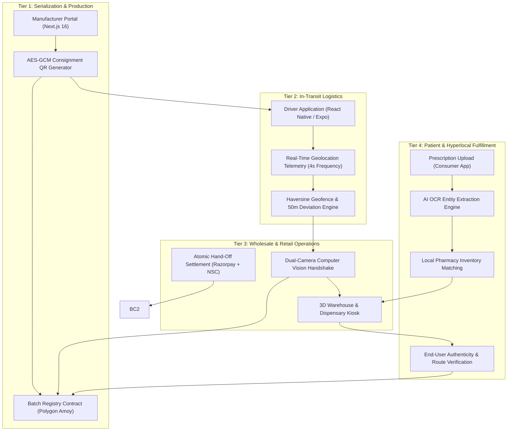

# Nirvana Smart-Chain (NSC)
### Enterprise Pharmaceutical Provenance, Real-Time IoT Telematics & Hyperlocal Fulfillment Platform

[](https://mic.gov.in)
[](https://sih.gov.in)
[](https://heritageit.edu)
[](https://polygon.technology)
[](#technology-stack)

---

## Executive Overview

**Nirvana Smart-Chain (NSC)** is an integrated pharmaceutical custody and supply chain verification platform. It solves medicine counterfeiting, cold-chain violations, and inventory fragmentation by unifying **factory serialization**, **in-transit route telematics**, **pharmacy warehouse management**, and **patient fulfillment** into a single cryptographic record.

Unlike legacy track-and-trace providers that only monitor internal manufacturing packaging lines, or centralized quick-commerce operators that bypass brick-and-mortar pharmacies using speculative dark stores, Nirvana operates as a **hyperlocal enablement layer for India's 12.4 lakh licensed retail chemists**. It combines code-enforced blockchain custody hand-offs, 4-second GPS telemetry with automated deviation alerts, and an AI-driven prescription OCR engine to bring instant, verified fulfillment to patients.

> [!NOTE]
> **Regulatory Alignment**: Engineered in accordance with the Central Drugs Standard Control Organisation (CDSCO) track-and-trace mandate, the Digital Personal Data Protection (DPDP) Act, and the phased Schedule H2 track-and-trace roadmap (extending through July 2028).

---

## Visual Telemetry & Platform Showcase

### 1. In-Transit Telematics & Dual-View Dispatch Monitoring
The platform streams continuous driver location telemetry to detect transit tampering or unauthorized offloading before it occurs.

| Real-Time Driver & Console Sync | Central Dispatch Route Oversight |
|:---:|:---:|
|  |  |
| *Synchronized dispatch telemetry: Live vehicle coordinates, speed, and real-time transit alerts alongside driver turn-by-turn navigation.* | *Full web dispatch overview displaying manufacturer origin, retailer destination, and geofence verification.* |

---

### 2. Enterprise Web Portals (Manufacturer, Wholesaler & Pharmacy)

| Multi-Role Enterprise Gateway | Pharmacy Telemetry & Financial Dashboard |
|:---:|:---:|
|  |  |
| *Role-based access gateway for manufacturers, wholesalers, and retail pharmacies.* | *Live inventory telemetry, real-time sales valuation, order queues, and restock alerts.* |

| 3D Dispensary Warehouse Shelf Kiosk | Smart Hand-Off & Blockchain Settlement |
|:---:|:---:|
|  |  |
| *Interactive warehouse storage bays, category segmentation, and SKU tracking.* | *Dual-camera QR validation, NSC protocol fee metering, and Razorpay fiat settlement.* |

---

### 3. Mobile Ecosystem (Driver Logistics & Consumer Mobile App)

| Driver Telemetry & Navigation | Patient Provenance & Cold-Chain Proof | Zero-Touch Prescription Ordering |
|:---:|:---:|:---:|
|  |  |  |
| *4-second GPS streaming with automatic alerts for deviations over 50 meters.* | *Consumer verification showing manufacturer pedigree, cold-chain log, and pharmacy license.* | *AI OCR prescription parser routing demand to nearest licensed pharmacy.* |

---

## The Market Opportunity & Industry Problem

* **Spurious & Substandard Drug Infiltration**: CDSCO and state testing laboratories consistently flag **167 to 211 drug batches per month** as Not of Standard Quality (NSQ). A December 2024 regulatory raid in Kolkata resulted in the seizure of ₹6.6 Crore worth of spurious pharmaceuticals that completely lacked supporting import and transport documentation.
* **Vulnerability of Static 2D Barcodes**: Conventional physical stickers and QR codes are easily photocopied or attached to fake formulations. Current logistics systems fail to verify whether a package actually traversed an authorized supply route.
* **Chemist Disintermediation**: Online pharmacies operating centralized dark stores have created deep friction with traditional retailers, leading to nationwide chemist shutdowns (including the AIOCD strike on May 20, 2026). Nirvana addresses this by routing 100% of consumer orders to verified neighborhood pharmacies.
* **Scale of Chronic Healthcare in India**: With 101 million diabetics and 315 million individuals diagnosed with hypertension (ICMR-INDIAB), recurring prescription refilling represents a high-volume, mission-critical market requiring end-to-end provenance.

---

## Core Product Innovations & Differentiators

1. **Unified Multi-Tier Architecture**  
   Manufacturers, logistics providers, licensed wholesalers, retail pharmacies, and end patients operate on a single shared cryptographic record rather than disconnected, proprietary databases.
2. **Code-Enforced Custody Hand-Offs**  
   Physical transfers require a cryptographic match between the scanning wallet, the receiver address embedded in the consignment QR, and the smart contract state machine. Duplicate scans are rejected, and unauthorized packs cannot skip verification stages.
3. **KYC-Permissioned Network**  
   Participation requires verifiable government credential checks via DigiLocker and biometric facial verification, eliminating rogue distributors and unverified intermediaries.
4. **Active Route Telematics (IoT Telemetry)**  
   Driver smartphones log GPS telemetry every 4 seconds. The backend calculates real-time route deviation; any variance exceeding 50 meters from the prescribed path flags an instant security alert to dispatch.
5. **Synchronized Financial and Custody Settlement**  
   Custody transitions, fiat payment releases (via Razorpay), and on-chain protocol fees execute concurrently upon successful physical scan and acceptance.
6. **Hyperlocal Micro-Fulfillment ("Blinkit for Neighborhood Pharmacies")**  
   Converts independent retail chemists into localized, on-demand fulfillment nodes. Patients receive their medication within minutes without bypassing local small businesses.
7. **AI Prescription OCR with Automated Inventory Discovery**  
   Patients capture a photograph of their doctor's handwritten prescription. Computer vision and OCR models extract medication entities and automatically match required quantities against real-time local pharmacy inventories for dispatch.
8. **Patient-Facing Provenance Verification**  
   Consumers scan their medicine packaging to inspect verified manufacturer credentials, intermediate handling entities, temperature monitoring compliance, and expiry dates prior to consumption.
9. **Metered Micro-Fee Economics**  
   Supply chain tracking and baseline inventory tools are free to drive mass retail adoption. Revenue is generated via premium inventory analytics, chronic-care recurring refill subscriptions, and automated on-chain transaction micro-fees.

---

## Technical Architecture



---

## Technology Stack

| Domain | Framework / Library | Role & Functionality |
|:---|:---|:---|
| **Web Frontends** | Next.js 16.4, React 19.3, TailwindCSS, Lucide, Recharts | Enterprise portals for manufacturers, distributors, and pharmacies; 3D shelf visualization, real-time shipment monitoring, and analytics. |
| **Mobile Platforms** | React Native, Expo (SDK 52/57), React Navigation | Dedicated driver logistics tracking with background services; consumer prescription ordering and QR scanning. |
| **Backend & Microservices** | Python 3.10+, Flask, Flask-SocketIO, MySQL | Low-latency telemetry aggregation, route calculation, order queue management, and relational metadata persistence. |
| **Machine Learning & OCR**| Tesseract OCR, OpenCV, Scikit-Learn | Prescription document digitization, entity recognition, and seasonal demand forecasting based on symptom search trends. |
| **Smart Contracts** | Solidity 0.8.20, Hardhat, Ethers.js v6, OpenZeppelin | `newCardTransactionRegistry.sol` (state machine for consignments) and `newNirvanaToken.sol` (whitelist-controlled ERC-20 utility asset). |
| **Blockchain Infrastructure**| Polygon Amoy Testnet | High-throughput, low-fee public ledger recording immutable chain-of-custody milestones. |

---

## Financial Projections & Unit Economics

### Market Sizing
* **Total Addressable Market (TAM): ₹8,262 Crore / year**  
  Calculated across 12.4 lakh licensed pharmacies and distributors ($\times ₹5,990/\text{year}$), 101 million chronic-care patients ($\times ₹740/\text{year}$), and 3,000 major pharmaceutical manufacturers ($\times ₹1.5\text{ Lakh}/\text{year}$).
* **Serviceable Addressable Market (SAM): ₹180 Crore / year**  
  Digitally addressable segment within West Bengal (34,700 pharmacies and 2.1 million reachable chronic patients).
* **Serviceable Obtainable Market (SOM): ₹0.5 Crore run-rate**  
  Targeted 36-month milestone: 2,500 onboarded pharmacies (375 paid conversions), 100 wholesale distributors, and 60,000 active patients in the Kolkata metropolitan cluster.

### Unit Economics (Pharmacy Pro Tier)
```
Gross Annual Subscription Price:           ₹5,990
Annual Direct Cost to Serve:               ₹1,361  (Cloud, Gas, Messaging, OCR, Support)
Gross Margin:                              77.3%
Customer Acquisition Cost (CAC):           ₹3,250
Payback Period:                            8.4 Months
LTV / CAC Ratio:                           4.3x
```

### Commercial Revenue Channels
1. **Pharmacy Inventory Pro**: ₹599 / month (or ₹5,990 / year) for automated low-stock warnings, expiry analytics, shelf optimization, and unlimited app orders.
2. **Wholesaler Enterprise Pro**: ₹1,999 / month for multi-driver fleet telematics and verified dispatch reconciliation.
3. **Nirvana Care (Consumer Refill Subscription)**: ₹49 / month or ₹399 / year for automated prescription management and free priority local delivery.
4. **Protocol Verification Fees**: ₹3 per on-chain event beyond monthly baseline allowances.

---

## Competitive Matrix

| Capability / Metric | Legacy Track & Trace (OPTEL, Antares) | Pharmacy ERPs (Marg ERP, Pharmarack) | Direct-to-Consumer e-Pharmacies (Tata 1mg, PharmEasy) | Nirvana Smart-Chain (NSC) |
|:---|:---|:---|:---|:---|
| **Coverage Scope** | Factory packaging line only | Back-office billing & inventory | Consumer order fulfillment | **End-to-End: Factory to Patient** |
| **Custody Verification** | Proprietary line aggregation | None (manual data entry) | None (internal dark store custody) | **Cryptographic On-Chain Verification** |
| **In-Transit Telematics** | Third-party hardware reliant | None | Driver location only | **4s GPS with 50m Geofence Deviation Alerts** |
| **Local Chemist Model**| Inapplicable | Software vendor only | Displaces local chemists via dark stores | **Hyperlocal Empowerment ("Blinkit for Chemists")** |
| **Consumer Transparency**| Restricted or non-existent | None | Tracking only | **Full Batch Provenance & Cold-Chain Audit** |
| **Prescription Digitization**| None | Manual data entry | Centralized pharmacist verification | **AI OCR with Real-Time Local Stock Routing** |
| **Cost Barrier to Entry**| Heavy CapEx per packaging line | ₹8,100 - ₹25,200 + AMC | High commission deductions | **Free Core Tier for Supply Tracking** |

---

## Installation & Deployment Guide

### System Prerequisites
* **Node.js** v18.0.0 or higher
* **Python** v3.10 or higher
* **MySQL** Server 8.0+
* **Expo CLI** (`npm install -g expo-cli`)
* **MetaMask** wallet provisioned with Polygon Amoy testnet tokens

---

### Step 1: Repository Clone
```bash
git clone https://github.com/Sourjya-Saha/Code_Nirvana.git
cd Code_Nirvana
```

### Step 2: Smart Contract Compilation & Deployment
```bash
cd frontend
npm install
npx hardhat compile

# Deploy to Polygon Amoy Testnet
npx hardhat run scripts/deploy.js --network amoy
```

### Step 3: Web Enterprise Portal Setup
```bash
cd ../frontend-next
npm install
npm run dev
```
> Access portal interface at `http://localhost:3000`

### Step 4: Python Backend & AI Services Setup
```bash
cd ../unified_backend

# Initialize virtual environment
python -m venv venv
# Windows:
.\venv\Scripts\activate
# Linux/macOS:
source venv/bin/activate

# Install required dependencies
pip install -r requirements.txt

# Start core server
python server.py
```
> API endpoints and Socket.IO listeners initialize on `http://localhost:5000`

### Step 5: Mobile Applications (Driver & Consumer)

**Consumer Application (`appnirvana`):**
```bash
cd ../appnirvana
npm install
npx expo start
```

**Driver Telemetry Application (`driver_application_dev`):**
```bash
cd ../driver_application_dev
npm install
npx expo start
```

---

## Technology Readiness Level (TRL) & Roadmap

* **Current Stage: TRL 4 (Integrated Prototype Demonstrated)**  
  End-to-end integration verified on Polygon Amoy testnet with functional Next.js portals, background GPS driver applications, prescription parsing engines, and smart contract registry hand-offs using seeded data.
* **Month 1 - Month 3 (Hardening & Governance)**: Cryptographic migration to signed AES-GCM QR payloads, smart contract audit, DPIIT startup incorporation, and provisional patent filing.
* **Month 4 - Month 6 (TRL 5)**: Field deployment of a 25-pharmacy and 4-wholesaler pilot in the Kolkata metropolitan region.
* **Month 7 - Month 9 (TRL 6)**: Scaling to 500+ verified on-chain consignments with a 95% first-scan success rate and launching a 500-patient consumer refill beta.
* **Month 10 - Month 12**: Launch of production billing infrastructure and submission for Startup India Seed Fund (SISFS) through institutional incubation.

---

## Project Governance & Team

**Team Code Nirvana**  
*Department of Information Technology, Heritage Institute of Technology, Kolkata*

* **Srinjoy Roy** — *Team Lead & Systems Architect*  
  Backend systems, database optimization, AI OCR pipeline, and demand-prediction modeling. Led team to 1st place in Smart India Hackathon 2025.
* **Sourjya Saha** — *Full-Stack & Blockchain Lead*  
  End-to-end web and mobile system development, microservice integration, and Solidity smart contract engineering.
* **Aritra Dhar** — *Full-Stack & Mobile Developer*  
  Web application interface design, cross-platform mobile client integration, and contract testing.
* **Prof. Rituparna Sinha** — *Project Mentor & Institutional Advisor*

**Institutional Incubation Partner:**  
*Heritage Institute of Technology Pre-Incubation Centre (Heritage Incubation Cell), Anandapur, Kolkata.*

---

## Intellectual Property & License

* **Copyright (c) 2024-2026 Team Code Nirvana.** All rights reserved.
* **Provisional Patent Filing (Planned)**: *Method and Architecture for Multi-Party Pharmaceutical Custody Verification Using Bound Receiver Handshakes and Dynamic Route Geofence Enforcement*.
