# Nirvana Health-Chain (NSC)
### Verified Medicines, Factory to Patient — Supply Chain Tracking & Local Pharmacy Delivery

[](https://mic.gov.in)
[](https://sih.gov.in)
[](https://heritageit.edu)
[](https://polygon.technology)
[](#technology-stack)

---

## What is Nirvana Health-Chain?

**Nirvana Health-Chain** is an all-in-one medicine tracking and delivery platform. Today, factory tracking, pharmacy inventory software, and patient home delivery apps are completely separate systems that do not talk to each other. Nirvana connects all of them into one continuous digital record.

Instead of replacing neighborhood medical stores with corporate dark stores, Nirvana turns **licensed local pharmacies into rapid delivery hubs**—working like a "Blinkit for neighborhood chemists" while giving patients proof that their medicine is 100% genuine and safe.

> [!NOTE]
> Built in line with national drug safety guidelines, the Central Drugs Standard Control Organisation (CDSCO) track-and-trace rules, and India's mandatory QR code regulations for top medicine brands.

---

## Visual Platform Showcase

### 1. Patient & Driver Mobile Applications

| Home & Store Finder | Product & Order Screen | Authenticity & Cold-Chain Check | Driver Navigation & GPS |
|:---:|:---:|:---:|:---:|
| 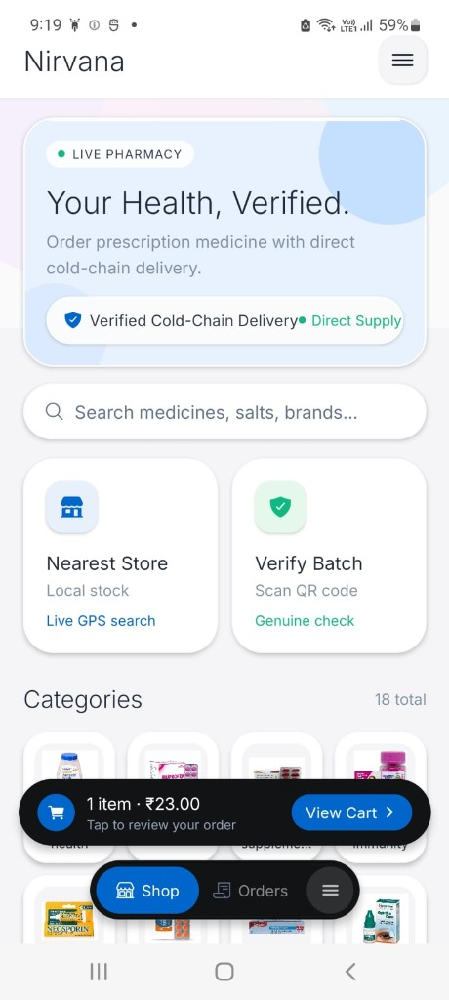 | 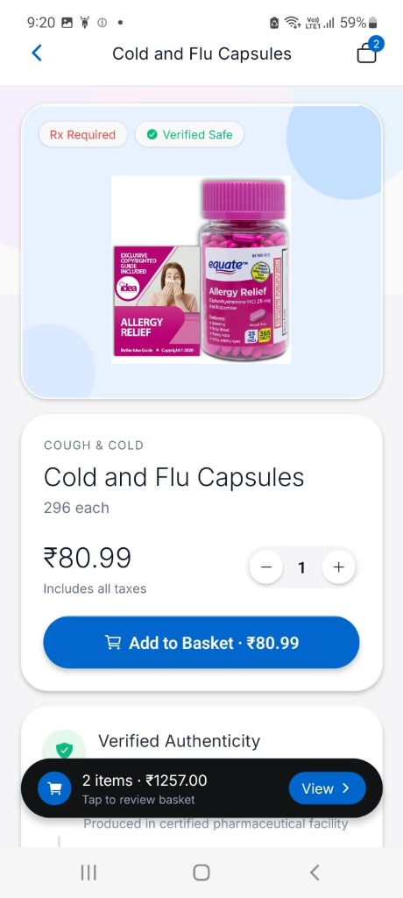 | 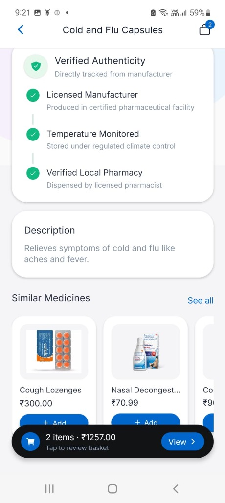 | 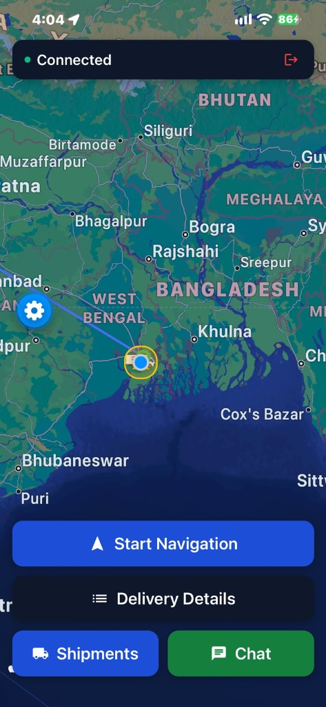 |
| *Find nearby licensed stores, check live local stock, and scan batch QR codes.* | *Browse catalog, view prescription requirements, and add items to basket.* | *Verify original manufacturer, storage temperature logs, and chemist details.* | *Real-time route navigation with live updates every 4 seconds.* |

---

### 2. Live Delivery & Route Tracking

| Synchronized Driver & Dispatch View | Central Delivery Route Map |
|:---:|:---:|
| 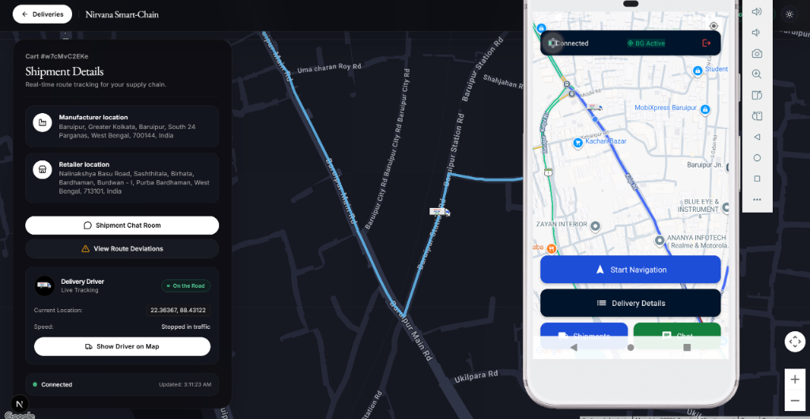 | 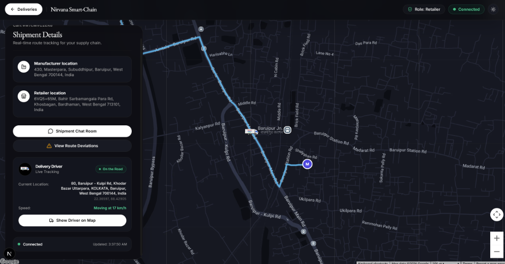 |
| *Real-time tracking showing driver location, speed, and transit status simultaneously on phone and web console.* | *Complete overview showing manufacturer origin, pharmacy destination, and automatic alerts for route detours.* |

---

### 3. Pharmacy & Wholesaler Web Portals

| Portal Sign-In Gateway | Pharmacy Stock & Sales Dashboard |
|:---:|:---:|
| 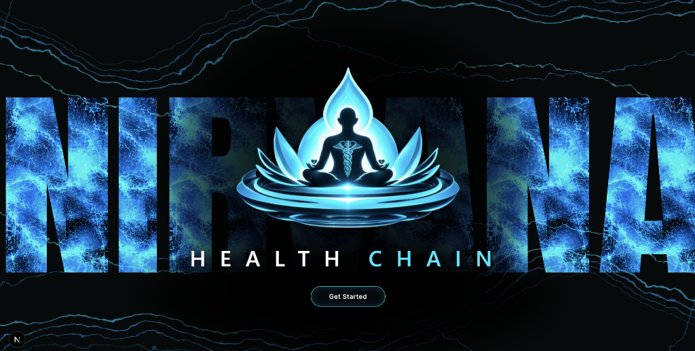 | 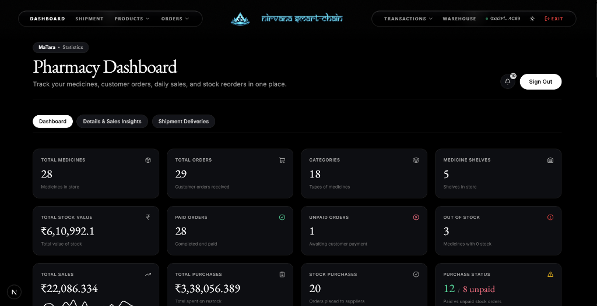 |
| *Simple role-based portal for manufacturers, wholesalers, and retail chemists.* | *Track total medicines in store, customer orders, daily sales, and reorders in one place.* |

| Pharmacy Shelf & Stock Organizer | Delivery Hand-Off & Payment |
|:---:|:---:|
| 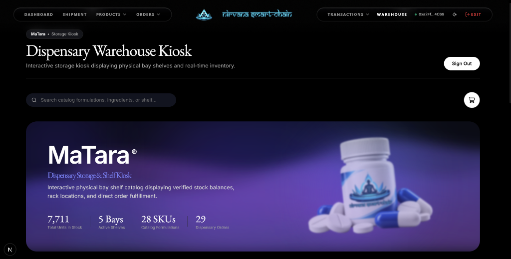 | 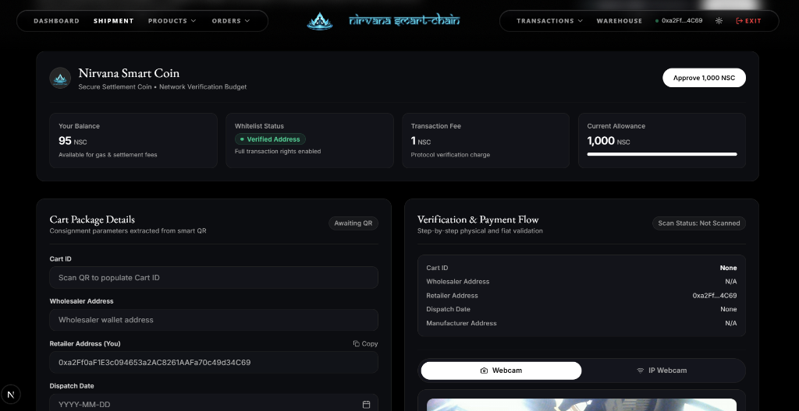 |
| *Clean shelf-by-shelf view of stored medicines, batch numbers, and stock levels.* | *Webcam QR scan confirms delivery receipt and releases payment automatically.* |

---

## Why This Matters (The Problem)

* **Fake and Substandard Medicines:** Government labs flag between **167 and 211 medicine batches every month** as failing basic quality standards. In a recent raid in Kolkata, authorities seized ₹6.6 Crore worth of suspected fake medicines that had no transport paperwork or legitimate origin.
* **Paper Stickers Can Be Copied:** Normal barcodes and QR stickers printed on boxes are easy to photocopy and put onto fake bottles. Today, once a box leaves the factory, no chemist or patient can prove the actual path it took.
* **Local Chemists Under Pressure:** Large e-pharmacy websites ship from their own private warehouses, taking business away from local chemists and sparking nationwide retailer strikes. Nirvana routes orders directly to nearby licensed shops instead.
* **Chronic Patients Need Regular Refills:** Over 101 million Indians live with diabetes and 315 million have high blood pressure. These families need regular, reliable, genuine medicines delivered to their doorstep without hassle.

---

## Key Features & How It Works

1. **Three layers in one continuous system**  
   Factory packaging numbers, pharmacy inventory counts, and patient refill orders all update on a single shared record.
2. **Custody locked by code, not paper**  
   Medicine transfers only succeed when authorized digital IDs, QR codes, and steps match. Fake boxes cannot enter the system, and duplicate scans of the same code are rejected.
3. **Verified-only network (KYC)**  
   Only licensed businesses verified through DigiLocker and facial scans can join, keeping unauthorized sellers and rogue distributors off the network.
4. **Live route tracking**  
   Driver phones log GPS location every 4 seconds. If a vehicle takes an unexpected detour of more than 50 meters, the system flags an immediate alert to prevent illegal offloading.
5. **Payment on delivery**  
   Payment settlements and custody transfers happen together. Suppliers get paid the moment the goods are physically scanned and accepted at the pharmacy counter.
6. **Built for local chemists ("Blinkit for neighborhood pharmacies")**  
   Instead of replacing family-run shops with dark stores, nearby customer orders are routed to licensed neighborhood chemists for rapid, doorstep fulfillment.
7. **Simple prescription ordering (Smart OCR)**  
   Patients simply take a photo of their doctor's handwritten prescription. The system automatically reads the medicine names, checks stock across nearby stores, and sends the order to the closest shop with full availability.
8. **Patient-facing proof**  
   Patients scan the medicine box with their phone camera to verify its authentic maker, storage temperature, past handlers, and expiry before taking a dose.
9. **Fair pricing model**  
   Core supply chain tracking and basic inventory software are free for small pharmacies, while advanced management tools and automated refills are paid.

---

## System Overview

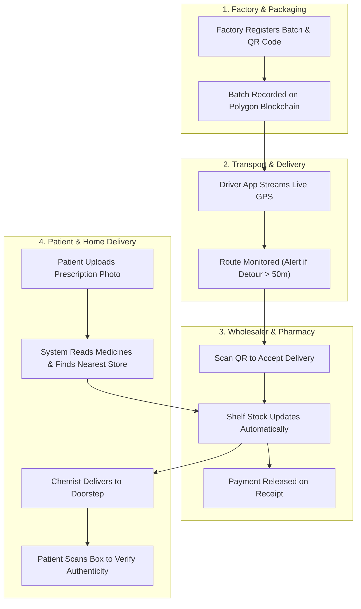

---

## Technology Stack

* **Web Frontends:** Next.js, React, TailwindCSS (Manufacturer, Wholesaler, and Pharmacy dashboards; inventory management and order processing).
* **Mobile Apps:** React Native with Expo (Driver navigation app with background GPS tracking; Consumer app for store search, prescription upload, and QR verification).
* **Backend Services:** Python (Flask, Socket.IO, MySQL database) for real-time driver tracking, store inventory lookup, and order management.
* **Prescription Scanning (OCR):** Tesseract OCR and computer vision to extract medicine names from prescription photos.
* **Blockchain Layer:** Solidity smart contracts deployed on the **Polygon Amoy Testnet** for tamper-proof hand-offs and automated protocol accounting.

---

## Business Model & Economics

### Market Potential
* **Total Addressable Market (TAM): ₹8,262 Crore / year**  
  Covering 12.4 lakh licensed chemists and distributors (at ₹5,990/year), 101 million chronic patients (at ₹740/year), and 3,000 pharma manufacturers.
* **Serviceable Market (SAM): ₹180 Crore / year**  
  Digitally-ready pharmacies and chronic-care patients across West Bengal.
* **Target Milestone (SOM): ₹0.5 Crore run-rate**  
  Initial rollout targeting 2,500 pharmacies, 100 wholesalers, and 60,000 patients in the Kolkata region.

### Unit Economics (Per Pharmacy)
* **Annual Subscription Price (Pro):** ₹5,990 / year
* **Annual Cost to Serve:** ₹1,361 / year (server hosting, messaging, gas fees, support)
* **Gross Profit Margin:** **77%**
* **Payback Period:** **8.4 months**

### How the Platform Earns Revenue
1. **Pharmacy Pro (₹599/month or ₹5,990/year):** Expiry alerts, automated reorder suggestions, shelf organizer, and unlimited customer orders.
2. **Wholesaler Pro (₹1,999/month):** Driver fleet tracking, delivery proof, and dispatch reconciliation.
3. **Nirvana Care (₹49/month or ₹399/year):** Automatic monthly prescription refills with priority local delivery for patients.
4. **Basic Tracking & Inventory:** **Free forever** to help neighborhood chemists get started without friction.

---

## Comparison With Existing Solutions

| Feature | Factory-Only Trackers (OPTEL) | Pharmacy Software (Marg ERP) | Online Pharmacies (Tata 1mg, PharmEasy) | Nirvana Smart-Chain |
|:---|:---|:---|:---|:---|
| **Coverage** | Factory lines only | In-store billing only | Private delivery warehouses | **Complete journey: Factory to Patient** |
| **Custody Check** | At factory packaging | Manual entry | None | **Digital hand-off check at every step** |
| **Delivery Tracking**| None | None | Simple courier tracking | **Live GPS with 50m detour alerts** |
| **Local Chemist Model**| Not applicable | Software provider | Replaces local shops with dark stores | **Empowers local neighborhood chemists** |
| **Patient Verification**| None | None | None | **Patients scan box to verify authenticity** |
| **Prescription Ordering**| None | Manual typing | Centralized warehouse dispatch | **Photo scan auto-matched to nearest store** |
| **Cost to Start** | High machine cost | ₹8,100 - ₹25,200 license | High sales commissions | **Free basic tracking and inventory** |

---

## Quick Setup Guide

### Requirements
* Node.js (v18+) and npm
* Python (v3.10+)
* MySQL database
* Expo CLI (`npm install -g expo-cli`)

---

### 1. Download Code
```bash
git clone https://github.com/Sourjya-Saha/Code_Nirvana.git
cd Code_Nirvana
```

### 2. Web Portal Setup
```bash
cd frontend-next
npm install
npm run dev
```
> Portal opens at: `http://localhost:3000`

### 3. Backend & AI Server Setup
```bash
cd ../unified_backend
python -m venv venv

# Windows
.\venv\Scripts\activate
# Linux/macOS
source venv/bin/activate

pip install -r requirements.txt
python server.py
```
> Server runs at: `http://localhost:5000`

### 4. Mobile Applications

**Consumer App:**
```bash
cd ../appnirvana
npm install
npx expo start
```

**Driver App:**
```bash
cd ../driver_application_dev
npm install
npx expo start
```
> Open Expo Go on your mobile phone and scan the QR code displayed in your terminal.

---

## Team & Institutional Support

**Team Code Nirvana**  
*Department of Information Technology, Heritage Institute of Technology, Kolkata*

* **Srinjoy Roy** — *Team Lead & Systems Architect*  
  Backend architecture, database design, and AI integration, including OCR-based data extraction and demand-sensing model development
* **Sourjya Saha** — *Full-Stack Web/Mobile Application & Blockchain Developer*  
  End to end web/mobile application development, frontend–backend integration, and blockchain
* **Aritra Dhar** — *Web/Mobile Application Developer & Blockchain Developer*  
  End to end web/mobile application development and blockchain implementation.
* **Prof. Rituparna Sinha** — *Project Mentor & Institutional Advisor*

**Incubation Center:**  
*Heritage Institute of Technology Pre-Incubation Centre (Heritage Incubation Cell), Anandapur, Kolkata.*

---

## Project Status & Recognitions

* **Winner**, Smart India Hackathon (SIH) 2025 (Problem Statement: SIH25057 / MoE Innovation Cell & AICTE)
* **Finalist**, YUKTI Innovation Challenge 2025 & AICTE Productization Fellowship (*IR2024-924421*)
* **Winner**, HackHeritage 2024
* **Current Development Stage**: Prototype demonstrated on Polygon Amoy testnet (TRL 4), targeting 25-pharmacy live pilot in Kolkata (TRL 5/6).
