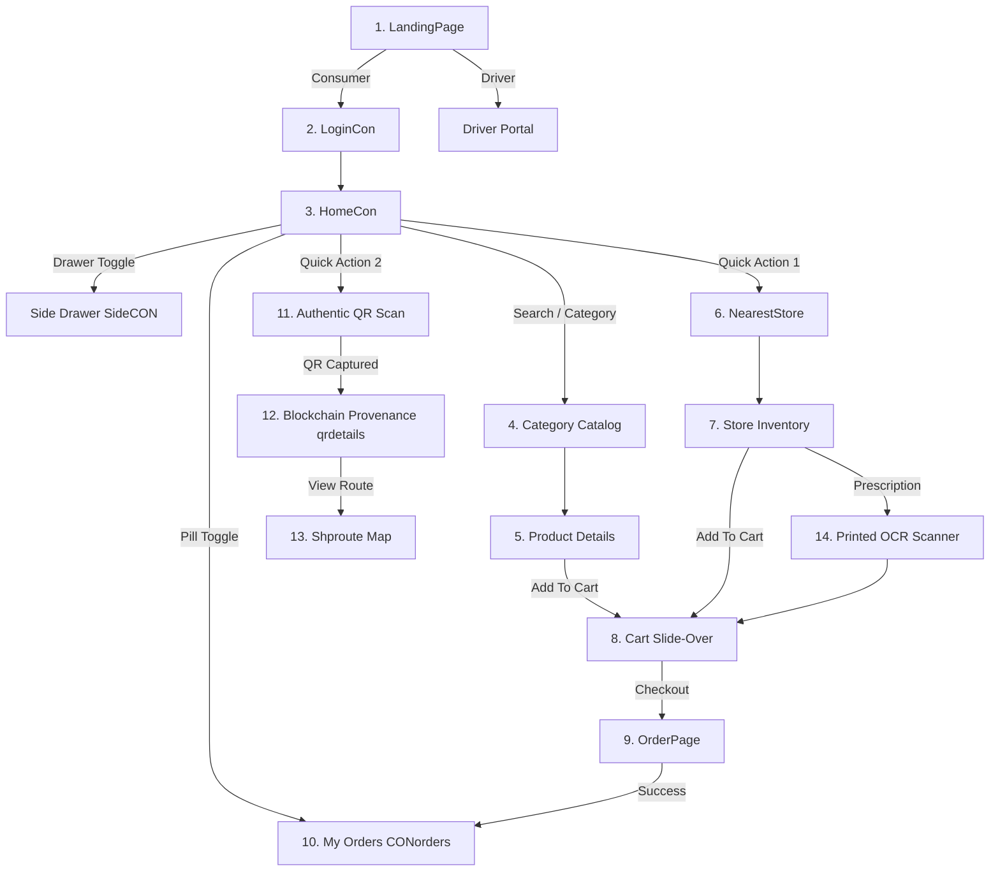

# Nirvana HealthChain — Complete UI/UX Design System & AI Prompt Specification

> **Version**: 1.0.0 Production Spec  
> **Target Audience**: AI UI Designers (Midjourney v6, v0.dev, Galileo AI, Figma AI, DALL-E 3, Stable Diffusion XL) & Frontend Engineers  
> **App Domain**: Web3 Pharmaceutical Quick-Commerce, Medicine Supply Chain Traceability & Anti-Counterfeiting  

---

## 1. Brand Identity & Design Language

### 1.1 Brand Essence
* **Brand Name**: Nirvana HealthChain
* **Tagline**: Verified Medicines, Transparent Supply Chain, Instant Delivery
* **Vibe & Aesthetic**: High-trust medical grade combined with cutting-edge Web3 fintech. Ultra-clean, modern, frosted glassmorphism accents, crisp typography, clinical yet warm and accessible.

### 1.2 Design Tokens & Color Palette

| Token Name | Hex Code | Usage | Meaning / Psychology |
| :--- | :--- | :--- | :--- |
| **Primary Brand Blue** | `#0A47F0` | Primary buttons, active tabs, brand titles, cart icons | Trust, clinical authority, precision |
| **Electric Indigo** | `#4F46E5` | Authentication gradients, blockchain badges | Security, smart contract technology |
| **Emerald Verified** | `#10B981` | Success states, authenticated badges, paid tags | Authenticity, safety, approved |
| **Amber Warning** | `#F59E0B` | Wholesale timeline, pending order tags, expiring meds | Caution, intermediate transition |
| **Crimson Expired** | `#EF4444` | Expired medicine banner, counterfeit warning | Critical hazard alert |
| **Pure Background** | `#F8FAFC` | Screen backgrounds, content areas | Clean clinical environment |
| **Card Surface** | `#FFFFFF` | Cards, modals, drawers, input containers | Elevation, focus |
| **Text Primary** | `#0F172A` | Headlines, product names, prices | High legibility |
| **Text Secondary** | `#64748B` | Subtitles, labels, timestamps | Subtle guidance |
| **Border / Divider** | `#E2E8F0` | Outlines, hair dividers, container borders | Subtle structure |

### 1.3 Typography Rules
* **Font Family**: Inter, SF Pro Display (iOS), or Roboto / Space Mono (for blockchain hashes)
* **Scale**:
  * **Display Title**: 32–36pt / ExtraBold / Tight letter-spacing (-0.5px)
  * **Screen Title**: 24–28pt / Bold
  * **Section Header**: 18–20pt / SemiBold
  * **Body / Text**: 14–16pt / Regular & Medium
  * **Caption / Badges**: 11–12pt / Bold / Uppercase / Letter-spacing (+1px)
  * **Monospace / Hash**: 11pt / Space Mono / Metamask & Tx IDs

### 1.4 Shapes, Depth & Elevations
* **Corner Radius**:
  * Action Buttons & Pills: `100px` (Full Pill)
  * Content Cards & Sheets: `16px` – `20px`
  * Product Thumbnails: `12px`
  * Floating Badges: `8px`
* **Shadows / Elevation**:
  * Soft Ambient Glow: `0px 4px 20px rgba(10, 71, 240, 0.08)`
  * Card Elevation: `0px 2px 8px rgba(15, 23, 42, 0.06)`
  * Floating Cart Pill: `0px 8px 24px rgba(10, 71, 240, 0.25)`

---

## 2. Global Signature Components

### 2.1 Floating Dual Pill Navigator (Bottom)
* **Structure**: Floating rounded container (`height: 48px`, `width: 220px`, `background: #FFFFFF`, `border-radius: 28px`, shadow).
* **Slider Pill**: Solid dark pill (`#000000`) sliding with spring haptics between **Home** and **My Orders**.
* **Active State**: White text on black capsule. Inactive: `#6B7280` text.

### 2.2 Floating Cart Capsule (Bottom Sticky)
* **Structure**: Full-width rounded capsule anchored 16px above bottom nav.
* **Color**: Solid Primary `#0A47F0` with subtle blur glow.
* **Content**:
  * Left: Cart icon `🛒` + `N items` + `• ₹Total.00`
  * Right: `View Cart ›` arrow prompt.

### 2.3 Slide-Over Drawer (`SideCON`)
* **Structure**: Modern 70% width slide-in sheet from left edge with soft dimmed backdrop.
* **Items**:
  * 📍 Shop from Nearest Store
  * 📦 My Orders
  * 🛡️ Verify Product Authenticity
  * 🚪 Log Out

---

## 3. Screen-by-Screen Specifications & AI Generation Prompts

---

### Screen 1: Splash & Landing Portal (`LandingPage`)

#### Purpose & Flow
The grand entrance to the application. Displays medical supply chain authority and directs the user to either the Consumer or Driver experience.

#### Layout & Content
* **Background**: Subtle medical supply chain/pharmacy imagery with soft ambient gradient overlay.
* **Typography**:
  * Large Hero Headline: **"Nirvana"** (Display 58pt) with shimmering chromatic ocean gradient (`#87A7E6` to `#0A47F0`).
  * Sub-headline: **"HealthChain"** (Display 48pt).
  * Tagline: "Decentralized Medical Supply & Verified Pharma Network".
* **CTAs**:
  1. Primary Pill Button: **"Login as Consumer"** (White glass backdrop, `#0A47F0` bold border & text).
  2. Secondary Pill Button: **"Login as Driver"** (Translucent stroke, minimal).

#### AI UI Prompt (Copy & Paste)
```markdown
Mobile app onboarding screen for "Nirvana HealthChain", ultra modern healthcare & blockchain app, iOS 18 style. Background shows an abstract high-tech medical laboratory and clean pharmaceutical aesthetics with soft white and light blue translucent overlay. Big bold typography in foreground reading "Nirvana HealthChain" with shimmering blue-teal gradient text. At the bottom, two rounded pill buttons: "Login as Consumer" with crisp blue outline and glossy finish, and "Login as Driver". Ultra-clean minimalist UI, 8k resolution, Figma showcase mockup, smooth curves.
```

---

### Screen 2: Authentication & Onboarding (`LoginCon`)

#### Purpose & Flow
Consumer authentication hub offering seamless tabbed toggling between Sign In, Sign Up, and Password Reset with fluid micro-animations.

#### Layout & Content
* **Background**: Deep Indigo Gradient (`#4F46E5` to `#3730A3`).
* **Header**: Animated text cycler: "Welcome Back" / "Create Account" / "Reset Password".
* **Segmented Switcher**: Translucent capsule tab selector with 3 items: `[ Sign In | Sign Up | Forgot ]`. Active item turns solid white with indigo typography.
* **Form Container**: White floating card (`border-radius: 20px`, elevated).
  * Input 1: User / Phone input with leading profile icon.
  * Input 2: Password input with lock icon and trailing eye toggle button.
  * Input 3 (Conditional on Sign Up): "Repeat Password" with verified check icon.
* **Submit CTA**: Vibrant Emerald button (`#10B981`, bold text: "Sign In" or "Create Account").

#### AI UI Prompt (Copy & Paste)
```markdown
Mobile app login and sign-up interface for a high-tech pharmacy application, iOS style. Background is rich royal indigo blue (#4F46E5). In the center, a modern floating white card with rounded corners contains text inputs with clean outline borders: username with user icon, password with eye toggle icon. Above the card is a 3-tab segmented pill switch [Sign In, Sign Up, Forgot] with frosted glass effect. Below the inputs is an emerald green (#10B981) action button labeled "Sign In". Ultra clean, crisp typography, Dribbble trending, Figma vector kit style.
```

---

### Screen 3: Consumer Home Dashboard (`HomeCon`)

#### Purpose & Flow
The main dashboard where consumers search for medications, trigger quick-access features (store locator, QR scan), browse medical categories, and discover products.

#### Layout & Content
* **Header Bar**:
  * Left: Hamburger drawer trigger (`☰`).
  * Center: Welcome title ("Welcome Back!").
  * Global Search Bar: Full-width pill with search icon `🔍`, placeholder *"Search medicines, categories..."*, instant dropdown preview.
* **Quick Action Cards (Two Columns)**:
  1. **"Shop from Nearest Store"**: Card with map pin icon `📍`, store distance routing.
  2. **"Verify Authenticity"**: Card with green shield checkmark `✓`, direct access to camera QR provenance scanner.
* **"Shop by Category" Grid**:
  * 4-column balanced grid with card tiles: Antibiotics, Pain Relief, Cardiac, Diabetes, Skin Care, Vitamins, First Aid, Supplements.
  * Each tile: Square rounded container with high-res medicine icon/photo, category label below.
* **Floating Bottom Pill**: Capsule switcher for `[ Home (Active) | My Orders ]`.

#### AI UI Prompt (Copy & Paste)
```markdown
Mobile app home screen dashboard for an on-demand medical delivery app named "Nirvana". Top header features a search bar with magnifying glass "Search medicines, categories...". Below search are two hero quick-action action cards side by side: "Shop from Nearest Store" with modern GPS pin icon, and "Verify Product Authenticity" with verified shield badge icon. Below is a section titled "Shop by Category" featuring a 4-column clean grid of medical category cards (Antibiotics, Cardiac, Pain Relief, Skincare). Bottom navigation features a floating modern dual-pill toggle [Home | My Orders]. Clean white and soft blue aesthetic, modern mobile UI, Behance featured.
```

---

### Screen 4: Category Products Catalog (`category`)

#### Purpose & Flow
Displays all available pharmaceutical products under a selected category with real-time in-category search.

#### Layout & Content
* **Header**: Category Title (e.g., *"Pain Relief & Analgesics"*), back button / hamburger toggle.
* **Search Bar**: Dedicated filter input *"Search in category..."*.
* **Product Card List (Vertical Stream)**:
  * Left: Product image in clean rounded container (`aspect-ratio: 1:1`).
  * Middle: Product name (Bold 16pt), sub-description / dosage form (13pt, `#64748B`).
  * Bottom/Right: Price tag in Indian Rupees (`₹249.00` in bold `#0A47F0`), small chevron or add arrow.
* **Background**: Clean medical white with subtle brand gradient accents.

#### AI UI Prompt (Copy & Paste)
```markdown
Mobile UI product listing screen for pharmacy app showing "Pain Relief" category. Top bar has back arrow and search input "Search in Pain Relief". Vertical list of pharmaceutical products: each card has a clean medicine box/strip image on the left, product title like "Paracetamol 650mg", dosage details in muted grey, and price "₹120" in bright cobalt blue on the right. Minimalist card borders, 16px rounded corners, sleek typography, production mobile app UI design.
```

---

### Screen 5: Product Details Screen (`product`)

#### Purpose & Flow
Comprehensive product deep-dive with dosage info, unit of measurement, quantity selector, add-to-cart CTA, similar medicines carousel, and sticky floating cart pill.

#### Layout & Content
* **Top Navigation**: Floating back circle button `←`.
* **Hero Image Showcase**: Large centered medicine box pack render with clean background reflection.
* **Product Detail Sheet**:
  * Title: E.g., *"Amoxicillin Trihydrate 500mg"*.
  * Pack Size / UOM: *"Strip of 10 Capsules"*.
  * Price & Stepper Row:
    * Left: Large bold price (`₹185.00`).
    * Right: Interactive quantity stepper (`[ - ]  2  [ + ]`).
  * Primary Action: Large full-width pill button: **"ADD TO CART"** (`#0A47F0`).
  * Description Accordion: Therapeutic indications, manufacturer, precautions.
* **Similar Products Carousel**:
  * Horizontal scrolling carousel showing related alternatives with quick "+ ADD" mini-buttons.
* **Bottom Floating Cart Bar**: Shows item count & total price when items exist in cart.

#### AI UI Prompt (Copy & Paste)
```markdown
Mobile UI product detail page for a prescription medicine on a medical ecommerce app. Top has back button and a pristine medicine package render on pure white surface. Bottom half is a slide-up sheet with product title "Amoxicillin 500mg", package size "10 Tablets", price "₹185", and a pill-shaped quantity selector [- 1 +]. Below is a solid vibrant blue button "ADD TO CART". Below that is a section for "Similar Products" with horizontally scrolling cards showing alternative medicines. Floating cart pill at the bottom edge. High-end modern UI, iOS layout.
```

---

### Screen 6: Nearest Store Locator (`NearestStore`)

#### Purpose & Flow
Location-aware pharmacy finder that detects GPS coordinates, allows radius filtering (5km, 10km, 15km), and displays authorized partner pharmacies.

#### Layout & Content
* **Header**: Title *"Nearest Store"*.
* **Radius Filter**: Dropdown selector with options `[ 5km | 10km | 15km ]`.
* **GPS Coordinate Banner**: Card with live latitude/longitude indicator and blue GPS marker.
* **Action**: "Detect Current Location" primary button.
* **Nearby Retailers Feed**:
  * Store Card:
    * Pharmacy Name (Bold 18pt, e.g., *"Apollo Pharmacy - Salt Lake"*).
    * Distance badge with location pin (e.g., *"1.4 km away"*).
    * Verified Partner checkmark.
    * Tap to enter store inventory.

#### AI UI Prompt (Copy & Paste)
```markdown
Mobile app screen for pharmacy store finder based on geolocation. Top has distance radius dropdown selector (5km, 10km, 15km) and a card showing current GPS coordinates with location pin icon. Below is a list of nearby pharmacies: clean white cards displaying pharmacy store name, distance badge "1.2 km away", operating status "Open", and right arrow. High contrast clinical blue (#0A47F0) accents, light grey background, clean iOS interface.
```

---

### Screen 7: Retail Store Inventory & Quick Order (`store`)

#### Purpose & Flow
Specific retailer inventory view where users can order medicines directly from that specific brick-and-mortar chemist.

#### Layout & Content
* **Header**: Store banner with store name, partner ID, and user session badge.
* **Inventory Catalog**:
  * Table/Card format: Image thumbnail, medicine name, unit price, inline counter (`[-] Qty [+]`) and `"Add"` button.
* **Slide-in Cart Panel Trigger**: Direct toggle to see items added from this pharmacy.
* **Floating Cart Capsule**: Real-time counter and price summary with direct checkout link.

#### AI UI Prompt (Copy & Paste)
```markdown
Mobile app screen displaying a local pharmacy inventory list. Header displays "Apollo Pharmacy | Store #402". List of available in-stock medicines: each row has product thumbnail, brand name, price in INR, and an interactive quantity selector [- 1 +] with "Add" button. Bottom features a sticky floating blue cart bar displaying "3 items • ₹540.00 | View Cart >". Professional ecommerce design, responsive mobile UI.
```

---

### Screen 8: Slide-Over Cart & Checkout Drawer (`cart`)

#### Purpose & Flow
The side/bottom drawer showing current shopping cart items with immediate quantity modifications, line-item deletions, subtotal calculation, and checkout trigger.

#### Layout & Content
* **Drawer Header**: Title *"Shopping Cart"*, item count badge (*"3 Items"*), close `✕` button.
* **Cart Items Stream**:
  * Product thumbnail.
  * Title & unit price.
  * Inline stepper `[ - ] [ Qty ] [ + ]`.
  * Delete `✕` button on right edge.
* **Footer Section**:
  * Total Amount breakdown (`Total Amount: ₹720.00`).
  * Primary Action CTA: Large button: **"Proceed to Checkout"** (`#0A47F0`, rounded 12px).
* **Empty State**: Friendly medical bag illustration, *"Your cart is empty"*, *"Add medicines to get started"*.

#### AI UI Prompt (Copy & Paste)
```markdown
Mobile app slide-over shopping cart drawer UI. Header displays "Shopping Cart (3 Items)" with close button. Card list of items: each showing medicine thumbnail, name "Metformin 500mg", unit price, interactive quantity stepper [- 2 +], and remove cross icon. Bottom card section displays "Total Amount: ₹480.00" in large bold numbers and a solid cobalt blue button "Proceed to Checkout". Clean typography, Apple design guidelines, elegant shadows.
```

---

### Screen 9: Order Summary & Payment Gateway (`OrderPage`)

#### Purpose & Flow
Review order items, fill delivery details (recipient name & mobile number), and pick payment method (Cash on Delivery or Razorpay Online Payment).

#### Layout & Content
* **Header**: Title *"Order Details & Checkout"*.
* **Invoice Table**:
  * Header row: `[ Item | Qty | Price ]`.
  * Itemized rows with line totals.
  * Highlighted Total Row: Bold grand total in INR.
* **Delivery Information Form**:
  * Input 1: Customer Phone Number (numeric pad with phone icon).
  * Input 2: Delivery Address / Recipient Name (multiline text container).
* **Payment Selector Buttons**:
  1. **"Pay Online"**: Primary gradient blue button with Razorpay / Card / UPI shield icon.
  2. **"Cash on Delivery (COD)"**: Outlined secondary button.
  3. **"Cancel"**: Ghost dismiss button.

#### AI UI Prompt (Copy & Paste)
```markdown
Mobile app order checkout and payment screen. Top section has a clean receipt invoice card showing ordered medicines, quantities, and total amount "₹850.00". Below are two clean text inputs: "Mobile Number" and "Delivery Address". Bottom section has two prominent payment buttons: a glowing royal blue button "Pay Online (Cards / UPI)" and an outline button "Cash on Delivery (COD)". Modern fintech aesthetic, secure badge indicator, minimalist iOS design.
```

---

### Screen 10: Order History & Live Tracking (`CONorders`)

#### Purpose & Flow
Consumer's past order ledger displaying delivered & placed packages, product thumbnail carousels, status badges, and expandable accordion item breakdowns.

#### Layout & Content
* **Top Header**: Eyebrow *"YOUR HISTORY"*, Title *"My Orders"*, circular total orders count badge (`#0A47F0`).
* **Order Card Structure (Dual Split)**:
  * **Left Column**:
    * Box parcel icon in soft blue circle.
    * Status label: *"Delivered"* (Emerald) or *"Placed"* (Amber).
    * Date and timestamp.
    * Customer recipient name.
    * Item count pill (e.g., *"3 items"*).
  * **Right Column**:
    * Grand Total in bold (`₹640`).
    * Status Chip: `[ ✓ Paid ]` in emerald or `[ ⏳ Pending ]` in amber.
    * **Thumbnail Preview Strip**: Horizontal mini-thumbs of the ordered medications with a `+2` badge for overflow.
    * Chevron dropdown arrow to expand order breakdown.
    * **"Rate Products"** star button (`#D97706`).
* **Expandable Product Dropdown Accordion**:
  * Expands on tap to reveal each medicine's thumbnail, title, category, quantity `×2`, and unit price.
* **Bottom Floating Pill Navigator**: `[ Home | My Orders (Active) ]`.

#### AI UI Prompt (Copy & Paste)
```markdown
Mobile app "My Orders" order history screen for healthcare app. Top header says "YOUR HISTORY" and "My Orders" with total count circle badge. List of stylish order cards: left side displays parcel icon, delivery status "Delivered", date, and recipient name; right side displays total price "₹640", a green "Paid" pill badge, and a horizontal preview row of miniature medicine product images with a "+2" overflow tag. Below each card is a "Rate Products" star button. Tap to expand accordion showing itemized list. Bottom has dual pill navigator. Clean, premium UI design.
```

---

### Screen 11: Product Authenticity QR Scanner (`authentic`)

#### Purpose & Flow
Interactive camera scanner allowing the consumer to point their lens at the medicine packaging QR code to verify on-chain authenticity.

#### Layout & Content
* **Header**: Title *"Scan Product QR for Details"*.
* **Camera Viewport**:
  * Centered 90% width rounded viewfinder (`border-radius: 16px`).
  * High-tech target reticle / scanner crosshair animation overlay.
  * Auto-sleep power saver message if idle: *"Camera Off - Tap to Turn On"*.
* **Bottom Controls**:
  * Large capture button or auto-detect viewfinder.
  * Flashlight / torch toggle icon.
  * Instruction banner: *"Align the QR code on the medicine box within the frame to verify supply chain origin"*.

#### AI UI Prompt (Copy & Paste)
```markdown
Mobile app camera QR code scanner screen for medical anti-counterfeit verification. Top has header "Scan Product QR for Details". Center displays a camera viewfinder with rounded corners and glowing holographic cyan/blue corner bracket reticles framing the center. Subtle laser scan line across the viewfinder. Below is a bold primary action button "Capture QR Code". Dark translucent UI elements over camera view, high-tech cybersecurity and medical provenance theme.
```

---

### Screen 12: Blockchain Provenance & Supply Chain Traceability (`qrdetails`)

#### Purpose & Flow
The crown jewel screen of Nirvana HealthChain. Displays complete cryptographic provenance of the scanned medicine, verification badges, supply chain journey steps, participants, and wallet addresses.

#### Layout & Content
* **Hero Image Card**:
  * Thumbnail of the captured QR code image.
  * Overlay chip with unique batch ID: `ID: 0x8F9A...3B21`.
* **Action Buttons**:
  * `[ 📷 Retake Photo ]` (Secondary outlined).
  * `[ 🔍 Fetch Details / Re-verify ]` (Primary deep blue with spinner state).
* **Verification Banner**:
  * Emerald Shield Icon `🛡️`.
  * Title: **"Authenticated"** in `#065F46`.
  * Subtitle: *"Genuine & Authorized Pack"*.
  * Green glowing pulse badge: `[ • VERIFIED ]`.
* **Supply Chain Metrics Strip**:
  * 3 equal stat cards:
    1. **Participants**: Count (e.g., `3`) in Indigo `#6366F1`.
    2. **Products**: Count (e.g., `4`) in Amber `#F59E0B`.
    3. **Chain Steps**: Count (e.g., `3`) in Emerald `#10B981`.
* **Supply Chain Journey Timeline (Interactive)**:
  * Numbered vertical step milestones connected by glowing pipeline lines:
    * **Step 1: Manufacturing**: Manufacturer factory name, location address, timestamp.
    * **Step 2: Wholesale Distribution**: Warehouse hub, transfer date.
    * **Step 3: Retail Distribution**: Chemist dispensary, verified retail license.
* **Map Route CTA Button**:
  * Purple/Blue button: `[ 🗺️ View Route on Map | 3 stops → ]`.
* **Cryptographic Participant Cards (Expandable)**:
  * Manufacturer / Wholesaler / Retailer cards:
    * Status: `[ Verified Partner ]` badge.
    * Coordinates: `22.5726° N, 88.3639° E`.
    * Geocoded Address box with map pin.
    * **Blockchain Wallet Address**: Monospace container displaying MetaMask address: `0x71C...B492` with link icon.

#### AI UI Prompt (Copy & Paste)
```markdown
Mobile app screen showing blockchain pharmaceutical provenance and supply chain verification. Top card shows scanned QR photo with a batch ID tag. Below is a prominent green "Authenticated - Genuine & Authorized Pack" shield card with glowing VERIFIED badge. Below is a 3-column stats bar: 3 Participants, 4 Products, 3 Steps. Center features a vertical supply chain journey timeline with numbered dots connecting: Step 1 Manufacturer (indigo), Step 2 Wholesaler (amber), Step 3 Retailer (emerald) with geocoded addresses. Button "View Route on Map". At the bottom, expandable cards showing Ethereum wallet addresses in monospace font with blockchain link icon. Web3 medical app UI, ultra-detailed, Figma award-winner.
```

---

### Screen 13: Supply Chain Map Route Tracker (`shproute`)

#### Purpose & Flow
Interactive map displaying the physical geographical route that the medicine traveled from factory to warehouse to consumer's local pharmacy.

#### Layout & Content
* **Full-Screen Interactive Map View**: Mapbox / Google Maps clinical light theme.
* **Polyline Journey Route**: Glowing gradient route line linking geographic stops.
* **Custom Map Markers**:
  * 🏭 Factory icon pin (Manufacturer).
  * 🏢 Warehouse icon pin (Wholesaler).
  * 🏥 Pharmacy store pin (Retailer).
* **Bottom Floating Stop Carousel**:
  * Swipeable horizontal cards detailing stop distance, transit duration, and temperature-controlled cold chain integrity status (`❄️ 4°C - Cold Chain Maintained`).

#### AI UI Prompt (Copy & Paste)
```markdown
Mobile app GPS map route tracking screen for pharmaceutical shipment route. Full screen minimalist map with a glowing blue-to-teal polyline path connecting three custom map pins: Factory icon, Warehouse icon, and Pharmacy icon. At the bottom, floating rounded card sheet displaying "Transit History", showing distance traveled "142 km", arrival timestamp, and a green cold-chain status badge "❄️ Cold Chain Maintained (4°C)". Crisp vector map design, modern mobile UI.
```

---

### Screen 14: Prescription OCR & Document Scanner (`printed`)

#### Purpose & Flow
Allows users to upload or snap a photo of a doctor's printed prescription and uses OCR to extract medicine names automatically.

#### Layout & Content
* **Header**: Title *"Upload Prescription"*.
* **Document Upload Dropzone**:
  * Dotted border card with camera / file upload prompt.
  * Preview of scanned prescription document with extracted medicine highlights.
* **Extracted Medicine List**:
  * Detected items with confidence scores (e.g., *"Paracetamol 500mg - 98% match"*).
  * "Add All to Cart" action button.

#### AI UI Prompt (Copy & Paste)
```markdown
Mobile app prescription document scanner screen with OCR intelligence. Top has prescription upload zone with dashed border showing a scanned doctor prescription document with smart glowing bounding boxes highlighting detected medicine names. Below is a list of detected medicines with checkboxes and confidence badges "Amoxicillin 500mg (99% Match)". Bottom has a primary action button "Add Matched Medicines to Cart". Clean medical technology UI.
```

---

## 4. UI Asset & Mockup Generation Pipeline

### 4.1 Master Midjourney Parameter Matrix
When rendering mockups in Midjourney v6, append these flags to the prompts in Section 3:
```text
--ar 9:16 --v 6.1 --style raw --q 2 --s 250
```

### 4.2 Figma / v0.dev Prompt Template
```text
Create a production React Native / Tailwind component for [SCREEN NAME].
Use colors: Primary #0A47F0, Surface #FFFFFF, Background #F8FAFC, Success #10B981, Warning #F59E0B.
Border radius: 16px cards, 100px pills.
Follow iOS HIG guidelines with safe-area spacing and modern haptic micro-interactions.
```

---

## 5. Screen Navigation & State Diagram



---

*Document compiled and verified for the Nirvana HealthChain frontend codebase.*
